# David Pereira

Computer Science student based in Luxembourg, building software that connects AI, robotics, and everyday tools.

My projects range from mobile apps and community websites to drone interfaces, computer vision experiments, and local AI systems. I enjoy working across software and hardware, from designing an interface to integrating sensors and running services on my own server.

[Portfolio](https://pearlabs.dev/) | [LinkedIn](https://www.linkedin.com/in/davidpereira2803/)

## Selected projects

### Mobile and web applications

- **[The Munkeler](https://github.com/Davidpereira2803/imposter-hunt)** - A social deduction game played on one shared phone, with special roles, multilingual support, and AI-generated custom topics. Built with React Native, Expo, and Zustand. Previously called Imposter Hunt.
- **[ROS Monitor](https://github.com/Davidpereira2803/rosground)** - A mobile interface for connecting to ROS systems through rosbridge, subscribing to topics, and inspecting live telemetry. Built with React Native, Expo, and WebSockets.
- **[Alma da Beira Alta](https://github.com/Davidpereira2803/alma-da-beira-alta)** - A multilingual website for a Portuguese cultural association in Luxembourg, with event management, member registration, and an administration panel for content and finances. Built with React and Firebase.
- **[LetzGrade](https://github.com/Davidpereira2803/letzgrade-mobile)** - A student grade tracker with weighted calculations, academic year organization, and progress charts. Built with React Native and Firebase.

### AI, robotics, and optimization

- **[Project Noesis](https://github.com/Davidpereira2803/project_noesis)** - An experimental framework combining camera perception, a structured world model, memory, and local LLM reasoning. Separate perception and cognition threads keep vision processing independent of model responses. Built with Python, OpenCV, YOLOv8, and Ollama; physical robot integration is future work.
- **[TEMO / Mixed Reality Drone Control](https://github.com/Davidpereira2803/tello_mixed_reality_handcontrol)** - DJI Tello control through an ESP32/MPU9250 inclinometer, a PS4 controller, or smartphone IMU data, alongside facial emotion recognition and an ArUco target game. Extends earlier work on the [TEMO ROS 2 driver](https://github.com/Davidpereira2803/tello_ros_driver_TEMO), a fork of the SNT-ARG Tello driver.
- **[FireDrift](https://github.com/Davidpereira2803/firedrift)** - A deep learning coursework project exploring transfer learning from aerial fire imagery to wildfire spread direction prediction, with evaluation against baseline predictors. Built with Python and PyTorch.
- **[NSGA-II + COLM](https://github.com/Davidpereira2803/nsgaccolm)** - A collaborative university project combining GPU-accelerated evolutionary optimization with a compact transformer to generate candidates for multi-objective flow-shop scheduling.

## Hardware and self-hosting

I repurposed an old laptop into a home server, building a custom enclosure with 3D-printed components. It runs Ubuntu Server and MicroK8s for containerized workloads.

[Build notes and photos](Projects/HomeLab/Description.md)

## Technologies I work with

| Area | Technologies |
| --- | --- |
| Languages | Python, JavaScript, TypeScript |
| Web and mobile | React, Next.js, React Native, Expo, Firebase, Tailwind CSS |
| AI and computer vision | PyTorch, TensorFlow/Keras, OpenCV, YOLOv8, Ollama |
| Robotics and hardware | ROS 2, rosbridge, ESP32, MPU9250, DJI Tello |
| Infrastructure | Git, Docker, Ubuntu Server, MicroK8s |

## GitHub activity

Language percentages reflect code size in public repositories, not time spent or proficiency.

I'm interested in collaborating on practical AI tools, interactive robotics, and useful web or mobile applications.
